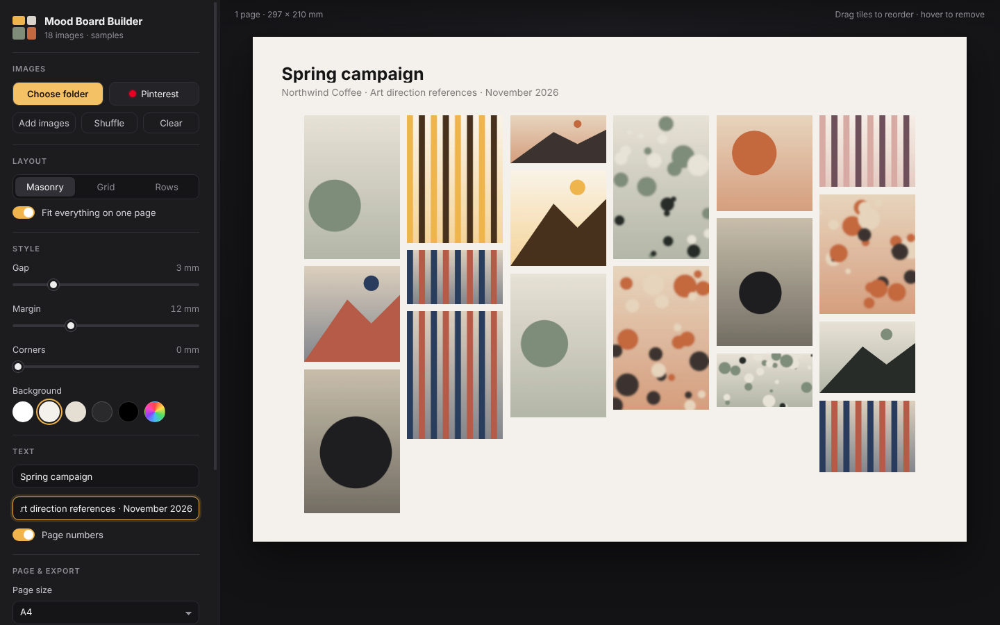
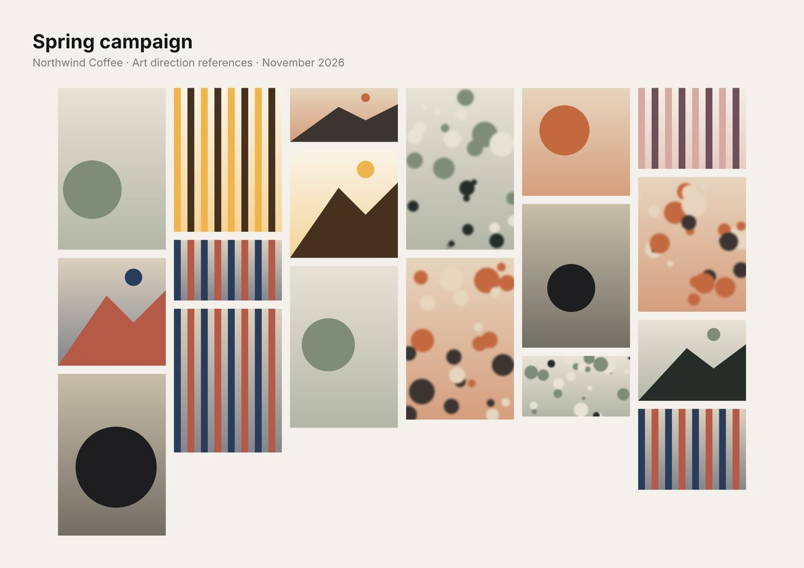

# Mood Board Builder

A Windows desktop app that turns a folder of reference images, or one of your Pinterest boards, into a clean PDF or JPEG mood board, ready to attach to an art direction brief.



## What it does

- **Bring images in** from a folder, by dragging files or folders onto the window, or by importing one of your Pinterest boards.
- **Three layouts**, switchable at any time:
  - **Masonry**: Pinterest-style columns that keep every image's shape.
  - **Grid**: equal cells (1:1, 4:3, 3:2, 3:4 or 16:9), cropped to fill.
  - **Rows**: justified rows of equal height with clean edges.
- **Fit everything on one page**, or set the columns or row height and let it flow over several pages.
- **Style it**: gap, margin, rounded corners, background colour, title and subtitle, page numbers.
- **Reorder** by dragging tiles, remove with the × on hover, or shuffle.
- **Export** at A4, A3, 16:9 slide, square or a custom size, in landscape or portrait:
  - **PDF** with real (selectable) text and each image embedded at up to 300 dpi.
  - **JPEG**, one file per page, at screen (144 dpi) or print (300 dpi) resolution.
- **Updates itself** from GitHub Releases.



## Install

Download `Mood-Board-Builder-Setup-x.y.z.exe` from [Releases](../../releases) and run it.

The installer isn't code-signed, so Windows SmartScreen may say it "protected your PC". Click **More info → Run anyway**.

## Pinterest setup (one-off)

Pinterest only lets apps read boards through its official API, so you need your own (free) developer app:

1. Go to [developers.pinterest.com/apps](https://developers.pinterest.com/apps/) and create an app.
2. Add this redirect URI to the app: `http://localhost:8085/callback`
3. In Mood Board Builder, click **Pinterest**, paste the App ID and App secret, then **Save and sign in**.

Your secret and sign-in token are encrypted on your PC with Windows' own data protection. Board images are cached in `%APPDATA%\Mood Board Builder\pinterest-cache`.

## Development

```bash
npm install
npm start        # run the app
npm test         # layout engine tests
npm run dist     # build the Windows installer and portable zip into dist/
```

### Releasing an update

1. Bump `version` in `package.json` (e.g. `1.0.1`) and commit.
2. Tag and push: `git tag v1.0.1 && git push origin main --tags`
3. The **Release** GitHub Action builds the installer on Windows and publishes a GitHub Release.
4. Installed copies check for updates on launch (and every 6 hours), download in the background and offer **Restart now**.

The repository needs to be **public** for the updater to see releases without a token.

## How it's built

- [Electron](https://www.electronjs.org/) for the desktop shell.
- `src/shared/layout.js`: a small, dependency-free layout engine (masonry, grid, justified rows, fit-to-page and pagination), with tests in `test/`.
- The on-screen preview and both exporters use the same page description, so what you see is what you export.
- [pdf-lib](https://pdf-lib.js.org/) writes the PDF; JPEGs are drawn on a canvas.
- [electron-updater](https://www.electron.build/auto-update) handles updates from GitHub Releases.

## Licence

MIT
